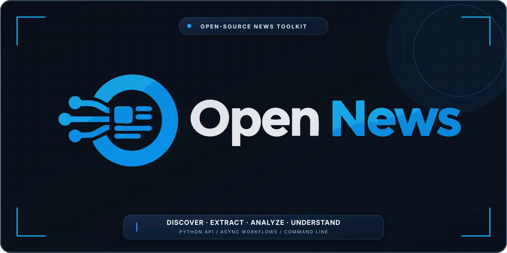
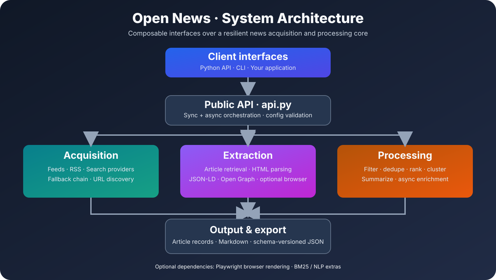
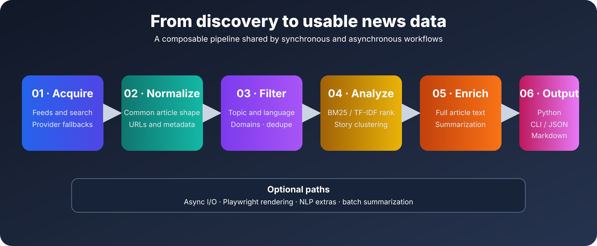

<p align="center">
  
</p>

<div align="center">

# Open News

### A lightweight Python toolkit for pulling, filtering, and understanding the news.

[](https://www.python.org/)
[](https://pypi.org/project/open-news-api/)
[](LICENSE)
[](https://github.com/alphap365/open-news/actions/workflows/ci.yml)
[](https://github.com/alphap365/open-news/releases)
[](docs/python-api.md)
[](docs/README.md)
[](https://colab.research.google.com/github/alphap365/open-news/blob/main/examples/colab/open_news_colab_demo.ipynb)

**Fetch → Extract → Filter → Group → Rank → Summarize → Export**

[Quick start](#-quick-start) · [Features](#-features) · [Architecture](#-architecture) · [Docs](#-documentation) · [Colab examples](#-colab-examples)

</div>

---

## Why Open News?

Open News is built for real-world news workflows: pulling headlines and article bodies, checking sources, filtering noise, grouping similar stories, and exporting results in a format your app or shell can use.

It is not a hosted reader or a single website scraper. You can use it as a Python library in your own project, or run the CLI directly from a terminal.

## At a glance

| Area | What it does |
|---|---|
| News discovery | Fetches category and location-based feeds, or searches by keyword |
| Source resilience | Tries multiple acquisition paths so one broken source does not kill the whole request |
| Article extraction | Pulls text, metadata, authors, dates, images, and source details |
| Website discovery | Finds articles through RSS discovery and fallback crawling |
| Processing | Filters by language, topic, and domains; merges exact normalized URL copies |
| Story grouping | Groups similar headlines while keeping distinct articles and their source names |
| Async workflows | Select async behavior with `async_=True` on supported APIs |
| Summarization | Produces lightweight summaries with optional NLP helpers |
| Export | Writes Markdown and clean JSON output |
| CLI | Works well in shell scripts and automation |

## ✨ Features

<details>
<summary><strong>News acquisition and search</strong></summary>

- `fetch()` for category and location-based news
- `search()` for keyword search, exclusions, locale, and date ranges
- Streaming helpers for incremental results
- Multi-source fallback logic when one provider is down or noisy

</details>

<details>
<summary><strong>Article extraction and website discovery</strong></summary>

- `get_article()` for synchronous or awaitable article retrieval
- `discover_and_get()` for RSS-first discovery with same-domain crawling when needed
- Optional Playwright rendering for JavaScript-heavy pages
- Metadata extraction using structured data, Open Graph, and HTML heuristics

</details>

<details>
<summary><strong>Processing and analysis</strong></summary>

- Topic and token filtering
- Domain allowlists and denylists
- Exact URL merging and similar-story grouping
- Relevance ranking with BM25, TF-IDF, or a simple fallback
- Similar-story clustering
- Batch and keyword-driven summarization

</details>

<details>
<summary><strong>Async API</strong></summary>

Use `async_=True` with `fetch()`, `search()`, `get_article()`,
`batch_summarize()`, or `search_and_summarize()` to get a coroutine to await.

</details>

## 📦 Installation

Requirements: Python 3.10 or newer.

```bash
python -m pip install open-news-api
```

Optional extras:

```bash
# Model Context Protocol server
python -m pip install "open-news-api[mcp]"
open-news-mcp

# Browser rendering for JavaScript-heavy pages
python -m pip install "open-news-api[js]"
playwright install chromium

# Optional NLP components, including BM25 and summarization helpers
python -m pip install "open-news-api[nlp]"
```

See the [MCP guide](docs/mcp.md) for client configuration, available tools,
and a runnable client example. MCP support is still growing; the Python API
currently exposes more features than the MCP server.

### Install and run with `uv`

Install the CLI as a standalone tool:

```bash
uv tool install open-news-api
open-news --help
```

Or run it without installing:

```bash
uvx --from open-news-api open-news search "artificial intelligence" --country in --limit 10
```

For use as a dependency in an application:

```bash
uv add open-news-api
# Choose optional features as needed:
uv add "open-news-api[js]"
# Or install both extras together:
uv add "open-news-api[js,nlp]"
```

After adding the `js` extra, install its browser runtime:

```bash
uv run playwright install chromium
```

Install from a local checkout:

```bash
git clone https://github.com/alphap365/open-news.git
cd open-news
uv sync --group dev
```

`uv sync` creates and manages the project environment. Run project commands with `uv run`; there is no need to activate the environment manually.

## 🧪 Colab examples

For notebook-friendly testing and quick experiments, see the [Colab examples](examples/colab/README.md). For runnable API demos covering story grouping, filters and ranking, async search, website discovery, and streaming, see the [examples index](examples/README.md).

The Colab folder includes:

- a ready-to-open Google Colab notebook
- a few small project-specific scripts for fetch/search/export flows
- a simple getting-started path for developers who want to test the library in a notebook environment

The project-level examples can be run with `uv run python examples/<script>.py` after `uv sync --group dev`.

The folder contains:

- `examples/colab/open_news_colab_demo.ipynb`
- `examples/colab/fetch_demo.py`
- `examples/colab/search_demo.py`
- `examples/colab/export_demo.py`

After running `uv sync --group dev` from the repository root, run an example with:

```bash
uv run python examples/colab/fetch_demo.py
```

## 🚀 Quick start

### Fetch current technology news

```python
from open_news import fetch

articles = fetch(category="tech", max_results=5)
for article in articles:
    print(article["title"], article["url"], article.get("sources", []))
    for related in article.get("similar_articles", []):
        print("  -", related["title"], related["url"])
```

### Search with a region and date range

```python
from open_news import search

articles = search(
    "renewable energy",
    country="in",
    start_date="2026-01-01",
    max_results=10,
)
```

### Use the async API

```python
import asyncio
from open_news import fetch

async def main():
    articles = await fetch(category="science", max_results=10, async_=True)
    for article in articles:
        print(article["title"])

asyncio.run(main())
```

### Extract an article

```python
from open_news import get_article

article = get_article("https://example.com/news/story")
print(article["title"])
print(article["text"])
```

### Rank and cluster stories

```python
from open_news import fetch, rank_articles, cluster_articles

# fetch() groups similar stories by default. Each result includes a
# representative article, sources, and similar_articles.
articles = fetch(category="tech", max_results=40)

ranked_stories = rank_articles(
    articles,
    query="artificial intelligence",
    method="auto",
)

for story in ranked_stories:
    print(story["title"], story.get("sources", []))
    for related in story.get("similar_articles", []):
        print("  -", related["title"], related["url"])

# Use cluster_articles() when you need explicit cluster metadata and members.
clusters = cluster_articles(ranked_stories, threshold=0.72, drop_singletons=True)
```

### Export results

```python
from open_news import export

markdown = export.to_markdown(clusters, path="out/stories.md")
json_text = export.to_json(clusters, path="out/stories.json")
jsonld = export.to_jsonld(clusters, path="out/stories.jsonld")
csv_text = export.to_csv(clusters, path="out/stories.csv")
llm_context = export.to_text(clusters, path="out/stories.txt")
```

Exporters return the serialized content and also write it to `path` when
provided. JSON-LD uses Schema.org `ItemList` and `NewsArticle` types; CSV
preserves nested values as JSON in cells; plain text provides labeled story
context suitable for LLM and retrieval workflows. See the
[structured export example](examples/structured_export_demo.py).

## 🧭 Architecture

Open News separates acquisition, extraction, processing, and presentation. The public API coordinates the workflow while specialized modules handle each stage.

<p align="center">
  <a href="docs/assets/architecture.svg">
    
  </a>
  <sub><a href="docs/assets/architecture.svg">Open full-size architecture diagram (SVG)</a></sub>
</p>

The main processing path looks like this:

<p align="center">
  <a href="docs/assets/pipeline.svg">
    
  </a>
  <sub><a href="docs/assets/pipeline.svg">Open full-size pipeline diagram (SVG)</a></sub>
</p>

See [Architecture](docs/architecture.md) for module responsibilities and data flow.

## ⌨️ Command-line interface

Once installed, the command is `open-news`:

```bash
open-news --help
open-news --version

open-news fetch --category tech --limit 5
open-news search "artificial intelligence" --country in --limit 10
open-news extract https://example.com/news/story
open-news discover https://example.com --limit 10
open-news search-site "climate policy" reuters.com
open-news cluster --query "AI regulation" --limit 30
open-news export input.json --md output.md --json clean.json
```

Run the same CLI from a project managed by `uv` with `uv run`:

```bash
uv run open-news --help
uv run open-news fetch --category tech --limit 5 --format json
uv run open-news cluster --query "AI regulation" --limit 30
```

For scripts, request JSON and pipe it into your preferred tools:

```bash
open-news search "AI" --format json | jq '.[].title'
# Or, without separately installing the CLI:
uvx --from open-news-api open-news search "AI" --format json | jq '.[].title'
```

For release history and version notes, see the [changelog](docs/changelog.md).

## 📚 Documentation

| Guide | Contents |
|---|---|
| [Installation](docs/installation.md) | Python setup, editable installs, and optional extras |
| [Python API](docs/python-api.md) | Sync and async entry points with examples |
| [CLI reference](docs/cli-reference.md) | Commands, options, and output formats |
| [Parameters](docs/parameters-reference.md) | Locale, dates, filters, streaming, and ranking |
| [Architecture](docs/architecture.md) | Modules, acquisition flow, and processing pipeline |
| [Release notes](docs/changelog.md) | What changed across releases |

## 🧪 Development and tests

The project uses `uv` and declares development tools in the `dev` dependency group:

```bash
uv sync --group dev
uv run pytest -q
uv run mypy src/open_news
uv build
```

Use `uv run pytest tests/test_cli.py -q` to run a focused test file. The repository includes unit, contract, mocked integration, feed-engine, extraction, processing, export, and CLI tests. Network-dependent behavior should be tested separately from deterministic offline tests.

`fetch()`, `search()`, `search_site()`, and `discover_and_get()` group similar
stories by default. Each result is a representative article with a `sources`
list and `similar_articles` records. Exact normalized URL copies are merged;
articles with similar titles but distinct URLs stay in the story group rather
than being discarded.

## ⚠️ Operational notes

- News acquisition depends on external providers and may return different results over time.
- `location` is a hint, not a guarantee that every result comes from that region. Use a domain allowlist when strict publisher geography matters.
- JavaScript rendering is optional and requires the `js` extra plus a Playwright browser installation.
- BM25 support is optional. With `method="auto"`, ranking can fall back to TF-IDF when the optional backend is unavailable.
- Extracted article metadata varies by publisher; dates, descriptions, and source attribution are best-effort fields.

## License

Open News is distributed under the MIT License. See [LICENSE](LICENSE).
