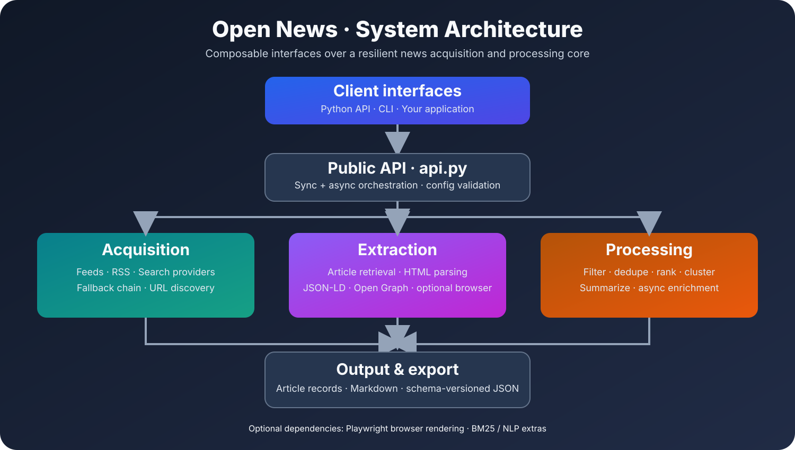
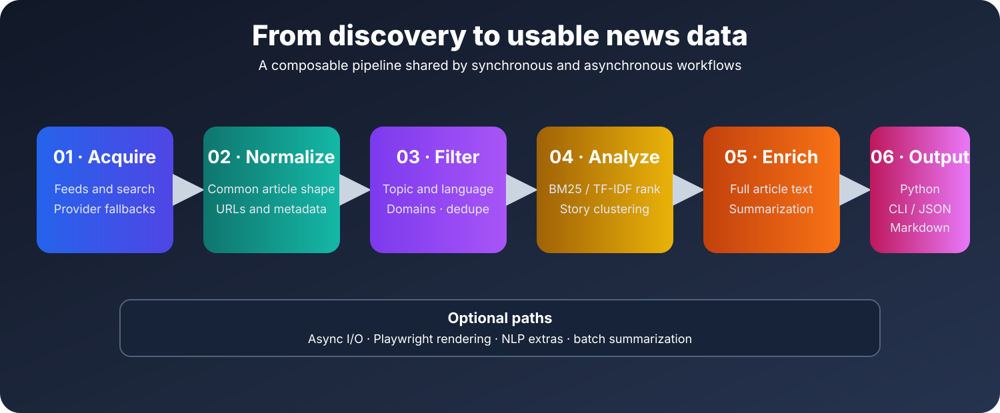

# Architecture

Open News is organized into acquisition, extraction, processing, and output layers. `api.py` is the public orchestration boundary; the CLI delegates to that API rather than implementing a separate news-processing stack.



[Open the full-size architecture diagram](assets/architecture.svg).

## Package map

```text
.
├── src/
│   └── open_news/
│       ├── __init__.py      Public exports and package version
│       ├── api.py           Sync/async public API and orchestration
│       ├── cli.py           Command-line interface
│       ├── config.py        Validated configuration objects
│       ├── core/            Extraction, rendering, and source resolution
│       ├── feeds/           News and RSS provider integrations
│       ├── fetch/           Article retrieval and website crawling
│       ├── processing/      Filtering, ranking, story grouping, feed generation, and summaries
│       ├── export/          Markdown and JSON serialization
│       ├── utils/           Date, text, HTTP, and user-agent helpers
│       └── py.typed         PEP 561 typing marker
├── tests/                   Unit, contract, and integration tests
├── docs/                    User, API, and architecture documentation
├── examples/                Runnable examples and notebooks
├── .github/                 CI, release, and wheel build workflows
├── pyproject.toml           Build, package, and tool configuration
└── MANIFEST.in              Source distribution contents
```

## Request lifecycle



[Open the full-size pipeline diagram](assets/pipeline.svg).

1. **Acquire:** `fetch()` or `search()` asks the feed layer for candidate records. Fetch acquisition uses a fallback-oriented chain rather than requiring every provider to succeed.
2. **Normalize:** provider-specific records are normalized into article dictionaries.
3. **Process:** configured language, topic/token, and domain filters run before exact URL normalization and story grouping.
4. **Enrich:** optional full-content extraction runs for each selected story representative. The async pipeline provides async enrichment behavior.
5. **Present:** each result is a representative article with `sources`, `similar_articles`, and cluster metadata; callers can still inspect each source URL.
6. **Export:** Markdown and JSON exporters serialize article or cluster-shaped data.

## Sync and async execution

The newer source exposes async entry points in addition to synchronous functions. The async path is not merely a synchronous wrapper for the whole workflow: async feed retrieval, article retrieval, pipeline enrichment, and batch summarization are implemented in their respective modules.

Use async entry points when the calling application already runs an event loop or needs to coordinate concurrent I/O. Use the synchronous API for scripts and ordinary blocking workflows.

## Acquisition fallback

The fetch engine coordinates multiple sources. The exact provider outcome depends on availability, parsing success, and whether usable results are returned. A source failure should be treated as a fallback condition where supported, not as proof that all news discovery has failed.

Search is a separate keyword-oriented path and should not be described as an identical copy of the category-fetch chain.

## Extraction strategy

Article extraction combines multiple signals, including structured metadata such as JSON-LD, Open Graph metadata, and HTML heuristics. Publisher pages vary considerably, so fields such as `publish_date`, `description`, and `source` are best-effort.

The optional browser renderer is intended for pages whose useful content is not available in the initial HTML response.

## Processing behavior

- **Filtering:** query and topic matching can narrow results.
- **Domain filtering:** whitelists keep allowed publishers; blacklists remove matching domains.
- **Exact URL merging:** normalized copies of the same article URL are merged, retaining source names and preferring the strongest article record.
- **Ranking:** relevance ranking can use BM25, TF-IDF, or a basic method.
- **Story grouping:** similar headlines are grouped by default; the best representative is returned together with similar source articles.
- **Summarization:** extractive summaries are produced locally from available article text.

## Output contracts

The export package provides Markdown and JSON serialization. JSON output supports a schema-versioned envelope and can remove internal implementation fields from exported records. Export functions can return the serialized text and optionally write it to a path.

## Design boundaries

- External news providers are not controlled by Open News.
- Location hints do not guarantee publisher origin.
- Browser rendering and NLP ranking are optional dependencies.
- Internal modules may evolve; applications should prefer imports from `open_news` where a public export exists.
